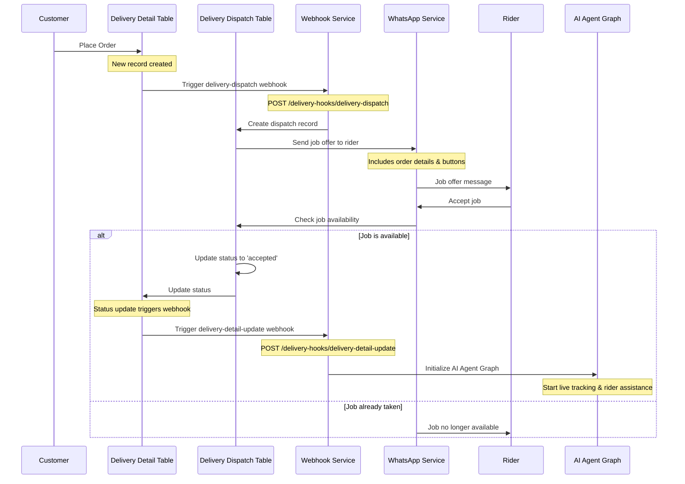

# Delivery Service Flow

## Flow Description

1. **Order Creation**
   - Customer places an order
   - New record created in DeliveryDetail table

2. **Initial Webhook**
   - Insert triggers delivery-dispatch webhook
   - Creates dispatch record
   - Sends job offer to rider via WhatsApp

3. **Rider Response**
   - Rider receives job offer with accept/decline buttons
   - On acceptance, system checks job availability

4. **Job Assignment**
   - If job is available:
     - Update dispatch status to 'accepted'
     - Update delivery detail status
     - Trigger delivery-detail-update webhook

5. **AI Agent Initialization**
   - Webhook initializes AI Agent Graph
   - Graph starts live tracking
   - AI Agent begins assisting rider through delivery process
