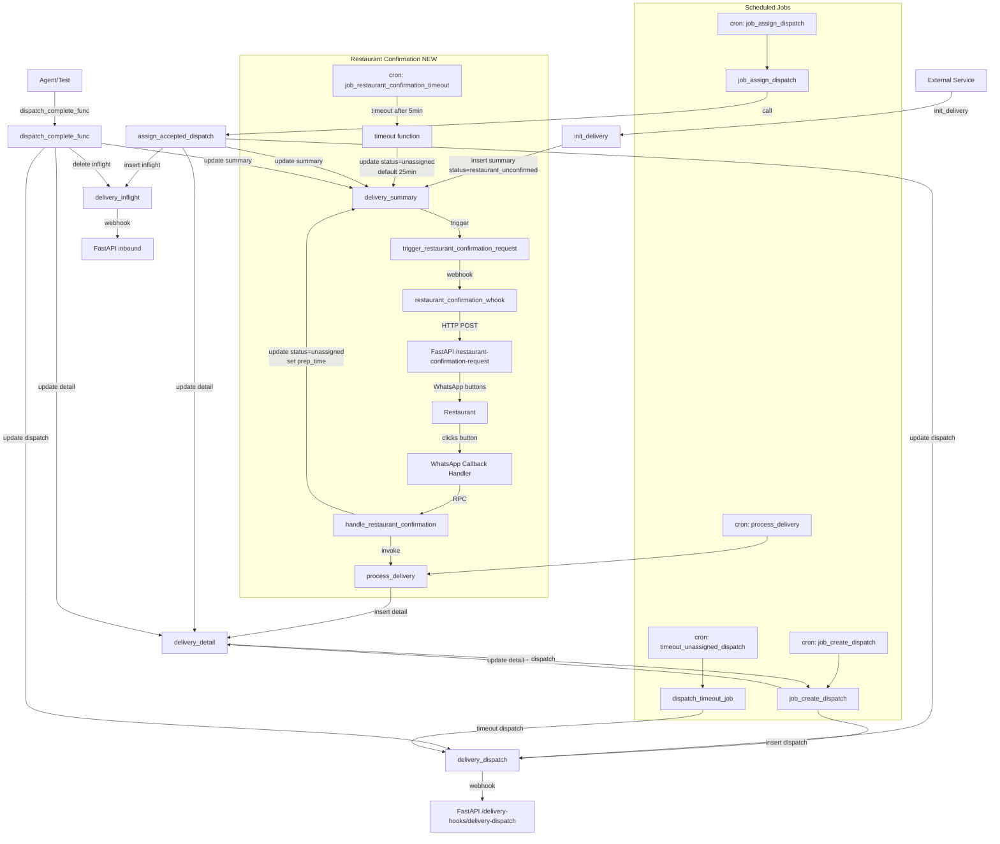

# Delivery Process Design

**Version:** 2.0 (Updated with Restaurant Confirmation Touchpoint)  
**Last Updated:** 2025-11-18

This document provides a clear, step-by-step reference for the Ordelo delivery workflow, covering initialization through completion and timeout handling.

## Document Overview

This design document covers the complete delivery workflow with the new **Restaurant Confirmation Touchpoint** that was added to optimize rider dispatch timing.

**What's New in v2.0:**
- Restaurant confirmation phase before rider dispatch
- New status: `restaurant_unconfirmed`
- WhatsApp-based prep time confirmation (5/15/25 minutes)
- Automatic timeout with default prep time
- Three new database columns for tracking confirmation data

**Sections:**
1. [High-Level Workflow Overview](#high-level-workflow-overview)
2. [init_delivery - Order Creation](#1-init_delivery-delivery-initiation)
3. [Restaurant Confirmation Webhook](#1a-restaurant-confirmation-webhook-new)
4. [Manual Confirmation Handler](#1b-handle_restaurant_confirmation-manual-confirmation)
5. [Automatic Timeout Job](#1c-job_restaurant_confirmation_timeout-automatic-timeout)
6. [process_delivery - Dispatch Creation](#2-process_delivery-delivery-detail-management)
7. [Workflow Diagram](#workflow-diagram)
8. [Database Schema Changes](#database-schema-changes)
9. [Integration Points](#integration-points)
10. [Monitoring Queries](#monitoring-queries)
11. [Rollback Plan](#rollback-plan)

---

## High-Level Workflow Overview

The delivery workflow consists of the following key phases:

1. **Order Creation** - External service initiates delivery via `init_delivery()`
2. **Restaurant Confirmation** - Restaurant confirms food preparation time (NEW)
3. **Dispatch Creation** - System creates delivery details and dispatches to riders
4. **Rider Assignment** - Rider accepts and gets assigned to delivery
5. **Delivery Execution** - Rider completes pickup and delivery
6. **Completion** - Order marked as completed

### New: Restaurant Confirmation Touchpoint

Before rider dispatch begins, the restaurant must confirm how long the food will take to prepare (5, 15, or 25 minutes). This ensures riders are dispatched at the optimal time.

- **Status Flow:** `restaurant_unconfirmed` → `unassigned` → `assigned` → `completed`
- **Timeout:** If no confirmation within configured time (default 5 minutes), system defaults to 25 minutes
- **Methods:** Manual (WhatsApp button) or Automatic (timeout)

### Key Components Added

| Component | Type | Purpose |
|-----------|------|---------|
| `restaurant_confirmation_whook()` | Trigger Function | Sends WhatsApp to restaurant on order creation |
| `trigger_restaurant_confirmation_request` | Database Trigger | Fires when status = 'restaurant_unconfirmed' |
| `handle_restaurant_confirmation()` | SQL Function | Processes manual confirmation from restaurant |
| `job_restaurant_confirmation_timeout()` | Scheduled Job | Auto-confirms after timeout with default prep time |
| `/delivery-hooks/restaurant-confirmation-request` | FastAPI Endpoint | Webhook receiver, sends WhatsApp buttons |
| `handle_restaurant_confirmation()` | WhatsApp Handler | Processes button clicks from restaurant |
| `rest_confirmed_at` | DB Column | Timestamp of confirmation |
| `rest_prep_time_minutes` | DB Column | Confirmed prep time (5/15/25) |
| `rest_confirmation_method` | DB Column | 'manual' or 'timeout' |

---

## 1. init_delivery (Delivery Initiation)

**Where This Fits:**
- **Step 1** in the delivery journey - Entry point when new order is created
- Creates the delivery_summary and sets initial status to `'restaurant_unconfirmed'`
- Does NOT immediately call `process_delivery()` - waits for restaurant confirmation first

**Invocation:**
- Called by external service: `init_delivery(p_cust_id VARCHAR, p_order_number VARCHAR)`

**Purpose:**
- Insert a new record into `delivery_summary` with restaurant & customer details
- Generate confirmation codes (restaurant & customer)
- Set initial status to `'restaurant_unconfirmed'` to trigger confirmation workflow
- Calculate default pickup_time (30 minutes from now)

**Dependencies:**
- Reads from: `customer_master`, `restaurant_master`, `ordelo_config`
- Writes to: `delivery_summary`
- Triggers: `trigger_restaurant_confirmation_request` (sends WhatsApp to restaurant)

**Side Effects:**
- Trigger fires and calls webhook `/delivery-hooks/restaurant-confirmation-request`
- WhatsApp message sent to restaurant with prep time options (5/15/25 min)

---

## 1a. Restaurant Confirmation Webhook (NEW)

**Trigger:**
```sql
CREATE TRIGGER trigger_restaurant_confirmation_request
AFTER INSERT ON delivery_summary
FOR EACH ROW
WHEN (NEW.status = 'restaurant_unconfirmed')
EXECUTE FUNCTION restaurant_confirmation_whook();
```

**Purpose:**
- Automatically send WhatsApp message to restaurant when new order created
- Request confirmation of food preparation time

**Webhook Function:** `restaurant_confirmation_whook()`
- Builds JSON payload with order details
- Makes HTTP POST to `/delivery-hooks/restaurant-confirmation-request`
- FastAPI endpoint sends WhatsApp with buttons: 5 min, 15 min, 25 min

**Dependencies:**
- Reads from: `ordelo_config` (ORDELO_APP_URL)
- Calls: FastAPI endpoint via `http_post()`

---

## 1b. handle_restaurant_confirmation (Manual Confirmation)

**Invocation:**
- Called via Supabase RPC from FastAPI endpoint
- Triggered when restaurant clicks WhatsApp button to confirm prep time

**Signature:**
```sql
CREATE FUNCTION handle_restaurant_confirmation(
  p_order_number VARCHAR,
  p_prep_time_minutes INTEGER
) RETURNS BOOLEAN
```

**Purpose:**
- Process manual restaurant confirmation of food preparation time
- Update delivery_summary with confirmed prep time
- Calculate pickup_time based on prep time (NOW() + prep_time)
- Transition order to `'unassigned'` status to trigger dispatch flow
- Eagerly call `process_delivery()` to start dispatch creation

**Parameters:**
- `p_order_number`: The order number to confirm
- `p_prep_time_minutes`: Restaurant's confirmed prep time (5, 15, or 25 minutes)

**Dependencies:**
- Reads from: `delivery_summary`
- Writes to: `delivery_summary` (status, rest_confirmed_at, rest_prep_time_minutes, rest_confirmation_method, pickup_time)
- Calls: `process_delivery()`

**Returns:**
- `TRUE` if update successful
- `FALSE` if order not found or already confirmed (idempotency)

**Side Effects:**
- Updates delivery_summary status to `'unassigned'`
- Calls `process_delivery()` to create delivery_detail records
- Triggers downstream dispatch creation workflow

**New Fields Updated:**
- `rest_confirmed_at`: Timestamp of confirmation
- `rest_prep_time_minutes`: Confirmed prep time (5, 15, or 25)
- `rest_confirmation_method`: 'manual' (vs 'timeout')
- `pickup_time`: NOW() + prep_time_minutes

---

## 1c. job_restaurant_confirmation_timeout (Automatic Timeout)

**Invocation:**
- Scheduled via pg_cron job (typically every minute)
- Can be called with optional `p_rest_ref` parameter for restaurant-specific processing

**Signature:**
```sql
CREATE FUNCTION job_restaurant_confirmation_timeout(p_rest_ref VARCHAR DEFAULT NULL)
RETURNS TABLE(action TEXT)
```

**Purpose:**
- Automatically timeout `restaurant_unconfirmed` orders after configured duration
- Support restaurant-specific timeout values via rest_ref parameter
- Default prep time to 25 minutes on timeout
- Transition order to `'unassigned'` status to continue normal dispatch flow

**Configuration:**
- **Default timeout:** `ordelo_config.RESTAURANT_CONFIRMATION_TIMEOUT` (default: 5 minutes)
- **Restaurant-specific:** `ordelo_config.{rest_ref}_RESTAURANT_CONFIRMATION_TIMEOUT`
- **Example:** `'WREN_RESTAURANT_CONFIRMATION_TIMEOUT'` for WREN restaurant
- **Fallback hierarchy:** Restaurant-specific → Global → Hardcoded (5 min)

**Parameters:**
- `p_rest_ref` (optional): Specific restaurant reference to process. If NULL, processes all timed-out orders.

**Dependencies:**
- Reads from: `delivery_summary`, `ordelo_config`
- Writes to: `delivery_summary` (status, rest_confirmed_at, rest_prep_time_minutes, rest_confirmation_method, pickup_time)

**Side Effects:**
- Updates delivery_summary status to `'unassigned'`
- Triggers downstream workflow (process_delivery will pick up these orders)

**New Fields Updated:**
- `rest_confirmed_at`: Timestamp of timeout
- `rest_prep_time_minutes`: 25 (default on timeout)
- `rest_confirmation_method`: 'timeout' (vs 'manual')
- `pickup_time`: NOW() + 25 minutes

**Example pg_cron Schedule:**
```sql
SELECT cron.schedule(
  'job_restaurant_confirmation_timeout',
  '* * * * *',  -- Every minute
  $$SELECT * FROM job_restaurant_confirmation_timeout()$$
);
```

---

## 2. process_delivery (Delivery Detail Management)

**Invocation:**
- Scheduled via `pg_cron`: every 5 seconds

**Signature:**
```sql
CREATE FUNCTION process_delivery() RETURNS TABLE(action TEXT)
```

**Purpose:**
- For each `unassigned` order in `delivery_summary`:
  1. Determine next vehicle type by rank
  2. Insert a new `delivery_detail` record if none exists
  3. If all vehicle types timed out, mark `delivery_summary.status = 'timedout'`

**Dependencies:**
- Tables: `delivery_summary`, `delivery_option`, `delivery_detail`

---

## 3. job_create_dispatch (Dispatch Creation)

**Invocation:**
- Scheduled cron job: every 5 seconds

**Signature:**
```sql
CREATE FUNCTION job_create_dispatch() RETURNS TABLE(action TEXT)
```

**Purpose:**
- For each `delivery_detail` with `status = 'unassigned'`:
  1. Find available riders via `get_available_riders(order_number, town, vehicle_type)`
  2. Batch dispatch candidates by `DISPATCH_BATCH_SIZE_<VEHICLE_TYPE>`
  3. Insert into `delivery_dispatch` (status = 'unassigned')
  4. Update `delivery_detail.status = 'vehicle_type_timedout'` if no riders

**Side Effects:**
- Triggers webhook on `delivery_dispatch` insertion:
  - HTTP POST `/delivery-hooks/delivery-dispatch`
- Sends WhatsApp messages to riders

---

## 4. job_assign_dispatch & assign_accepted_dispatch (Dispatch Assignment)

**Invocation:**
- Scheduled cron job: every 5 seconds

**job_assign_dispatch Signature:**
```sql
CREATE FUNCTION job_assign_dispatch() RETURNS TABLE(action TEXT)
```

**Purpose:**
- Find `delivery_detail` rows with status `'unassigned'` or `'vehicle_type_timedout'`
- Call `assign_accepted_dispatch(order_number)` for each

**assign_accepted_dispatch Signature:**
```sql
CREATE FUNCTION assign_accepted_dispatch(p_order_number VARCHAR) RETURNS BOOLEAN
```

**assign_accepted_dispatch Purpose:**
1. Select first `delivery_dispatch` with `status = 'accepted'` and not already inflight
2. Update:
   - `delivery_dispatch.status = 'assigned'`
   - `delivery_detail.status = 'assigned'`, set `dispatch_id` & `rider_id`
   - `delivery_summary.status = 'assigned'`
3. Insert into `delivery_inflight` (kicks off rider graph & missed‐dispatch notification)

---

## 5. dispatch_complete_func (Dispatch Completion)

**Invocation:**
- Called by agent or tests when delivery is complete: `dispatch_complete_func(p_dispatch_id BIGINT)`

**Purpose:**
- Update:
  - `delivery_dispatch.status = 'completed'`
  - `delivery_detail.status = 'completed'`
  - `delivery_summary.status = 'completed'`
- Remove inflight record: `DELETE FROM delivery_inflight`

---

## 6. TimeoutUnassignedDispatch (Unassigned Dispatch Timeout)

**Process:**
- Periodic SQL job (e.g. cron script)

```sql
UPDATE delivery_dispatch
SET status = 'timedout'
WHERE status = 'unassigned'
  AND (current_timestamp - dtts) > INTERVAL '30 seconds';
```

---

## Workflow Diagram



---

## Database Schema Changes

### delivery_summary Table - New Fields

Three new fields added to support restaurant confirmation touchpoint:

```sql
-- Timestamp when restaurant confirmed (manual or timeout)
rest_confirmed_at TIMESTAMP WITH TIME ZONE

-- Restaurant's confirmed prep time in minutes (5, 15, or 25)
rest_prep_time_minutes INTEGER

-- How confirmation was received: 'manual' or 'timeout'
rest_confirmation_method VARCHAR(20)
```

### Status Constraint Update

The `delivery_summary.status` CHECK constraint now includes the new status:

```sql
CHECK (status IN (
  'restaurant_unconfirmed',  -- NEW: Waiting for restaurant confirmation
  'unassigned',              -- Ready for dispatch creation
  'timedout',                -- All dispatch attempts failed
  'assigned',                -- Rider assigned
  'completed'                -- Delivery completed
))
```

### Configuration Keys

New configuration keys in `ordelo_config` table:

```sql
-- Global default timeout (minutes)
'RESTAURANT_CONFIRMATION_TIMEOUT' = '5'

-- Restaurant-specific timeout (optional, overrides global)
'{rest_ref}_RESTAURANT_CONFIRMATION_TIMEOUT' = '3'  -- Example: WREN_RESTAURANT_CONFIRMATION_TIMEOUT
```

---

## Integration Points

### FastAPI Endpoints

**New Endpoint:**
- `POST /delivery-hooks/restaurant-confirmation-request`
  - Receives webhook from database trigger
  - Fetches restaurant admin contact from `restaurant_master`
  - Sends WhatsApp message with prep time buttons (5/15/25 min)

### WhatsApp Handlers

**New Callback Handler:**
- Command: `/restaurantConfirmation`
- Handler: `handle_restaurant_confirmation()` in `on_callback_wa_handler.py`
- Registered in: `fapp_ordelo_agent.py`
- Calls: `handle_restaurant_confirmation()` RPC function

**Button Payload Structure:**
```json
{
  "command": "/restaurantConfirmation",
  "order_number": "WREN-12345",
  "prep_time_minutes": 15
}
```

---

## Status Transition Flow

### Complete Order Journey with Restaurant Confirmation

```
1. init_delivery()
   ↓
   status = 'restaurant_unconfirmed'
   ↓
   [Trigger fires → WhatsApp sent to restaurant]
   ↓
   ┌─────────────────────────────────────┐
   │  Restaurant Confirmation Phase      │
   │                                     │
   │  Option A: Manual (within 5 min)   │
   │  - Restaurant clicks button         │
   │  - handle_restaurant_confirmation() │
   │  - Sets prep_time (5/15/25)        │
   │                                     │
   │  Option B: Timeout (after 5 min)   │
   │  - job_restaurant_confirmation_     │
   │    timeout() runs                   │
   │  - Defaults to 25 minutes           │
   └─────────────────────────────────────┘
   ↓
   status = 'unassigned'
   pickup_time = NOW() + prep_time_minutes
   ↓
2. process_delivery()
   - Creates delivery_detail
   ↓
3. job_create_dispatch()
   - Creates delivery_dispatch
   - Sends to riders
   ↓
4. Rider accepts
   ↓
   status = 'assigned'
   ↓
5. Rider completes delivery
   ↓
   status = 'completed'
```

---

## Monitoring Queries

### Check Restaurant Confirmation Status

```sql
-- Orders waiting for confirmation
SELECT 
  order_number,
  rest_name,
  dtts as created_at,
  EXTRACT(EPOCH FROM (NOW() - dtts))/60 as minutes_waiting
FROM delivery_summary
WHERE status = 'restaurant_unconfirmed'
ORDER BY dtts DESC;

-- Recent confirmations
SELECT 
  order_number,
  rest_name,
  rest_prep_time_minutes,
  rest_confirmation_method,
  rest_confirmed_at,
  EXTRACT(EPOCH FROM (rest_confirmed_at - dtts))/60 as confirmation_time_minutes
FROM delivery_summary
WHERE rest_confirmed_at IS NOT NULL
ORDER BY rest_confirmed_at DESC
LIMIT 20;

-- Confirmation method breakdown
SELECT 
  rest_confirmation_method,
  COUNT(*) as count,
  AVG(rest_prep_time_minutes) as avg_prep_time,
  AVG(EXTRACT(EPOCH FROM (rest_confirmed_at - dtts))/60) as avg_confirmation_time_minutes
FROM delivery_summary
WHERE rest_confirmed_at IS NOT NULL
GROUP BY rest_confirmation_method;
```

---

## Rollback Plan

If the restaurant confirmation feature needs to be disabled:

### Option 1: Quick Disable (Keep Schema)

```sql
-- Disable trigger (stops WhatsApp messages)
ALTER TABLE delivery_summary DISABLE TRIGGER trigger_restaurant_confirmation_request;

-- Disable timeout job
SELECT cron.unschedule('job_restaurant_confirmation_timeout');

-- Update init_delivery to use 'unassigned' status
-- (Requires code change in init_delivery.sql)
```

### Option 2: Full Rollback (Remove Schema)

```sql
-- Drop trigger
DROP TRIGGER IF EXISTS trigger_restaurant_confirmation_request ON delivery_summary;

-- Drop functions
DROP FUNCTION IF EXISTS restaurant_confirmation_whook();
DROP FUNCTION IF EXISTS handle_restaurant_confirmation(VARCHAR, INTEGER);
DROP FUNCTION IF EXISTS job_restaurant_confirmation_timeout(VARCHAR);

-- Remove status from constraint
ALTER TABLE delivery_summary
  DROP CONSTRAINT delivery_summary_status_check,
  ADD CONSTRAINT delivery_summary_status_check
    CHECK (status IN ('unassigned', 'timedout', 'assigned', 'completed'));

-- Optional: Drop columns (data loss)
ALTER TABLE delivery_summary
  DROP COLUMN rest_confirmed_at,
  DROP COLUMN rest_prep_time_minutes,
  DROP COLUMN rest_confirmation_method;

-- Remove config
DELETE FROM ordelo_config WHERE config_key LIKE '%RESTAURANT_CONFIRMATION_TIMEOUT%';
```

---

*End of Delivery Process Design*
