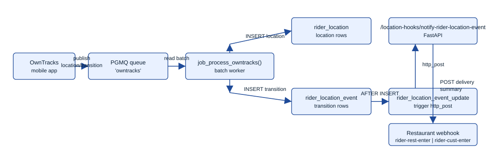
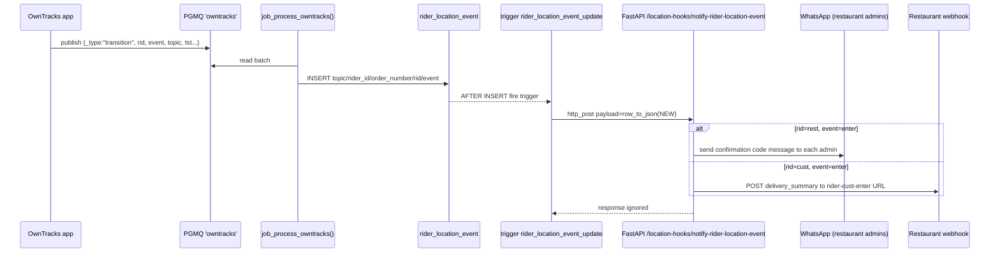
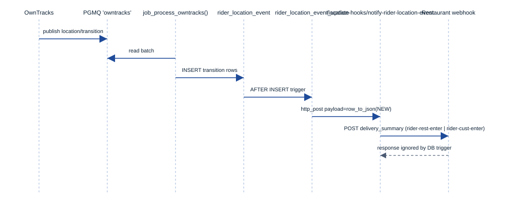

# Location Event Processing

This guide explains how OwnTracks location events travel from the queue into database tables and out to webhooks. It ties together `ordelo_datamodels/rider_location/rider_location.sql`, `ordelo_datamodels/rider_location/job_process_owntracks.sql`, and `watomation/routers/location_hooks.py`.

## On-demand rider location (WhatsApp and Telegram)

OwnTracks remains a legacy ingestion and map path; it is no longer a required
rider workflow. The separate `WaLocation` flow accepts open
`POST /wa-request-location` demands with public HTTPS callback URLs, validates the exact active
`delivery_inflight(order_number, dispatch_id, rider_id)` assignment, and asks
the assigned rider for a one-time current location on their job's channel only when an authorised
request needs one. Its durable request/observation schema and rollout boundary
are documented in [WaLocation Implementation Plan](wa_location_implementation_plan.md).

**The prompt is sent through the rider agent, not directly.** `WaLocation.request()`
validates and persists the demand synchronously, then schedules
`_prompt_rider_via_agent()` as a FastAPI background task (`schedule=background_tasks.add_task`
from `watomation/routers/wa_location_hooks.py`) and returns `202 waiting_for_rider`
immediately. `_prompt_rider_via_agent()`:

1. Probes `ThreadHandler.get_active_thread()` (non-mutating). If the rider has no
   active agent thread, it falls back to a direct `wa_client.request_location()`
   send — the pre-agent behavior — since the graph has no useful context to
   hydrate a brand-new thread with.
2. Otherwise it runs the rider graph with a system message ("Rider's location
   requested by the customer/restaurant...") and `wa_location_request_id` set in
   graph state. The rider agent's `request_rider_current_location` tool
   (`ordelo/agents/rider_agent.py`) sends a short intro line naming the requester,
   then the native WhatsApp location request, and records the resulting message
   id via `WaLocation.record_prompt_sent()` — this id is the primary correlation
   key for the rider's reply (see below).
3. If the LLM did not call the tool, one deterministic retry runs
   (`agent_node` forces the tool call, mirroring the existing
   `awaiting_cancel_reason` pattern). If that still fails, the request is marked
   `failed` via `WaLocation.mark_prompt_failed()`, which clears
   `wa_location_prompt_time` so the cooldown does not block a later retry.

This keeps the location ask inside the rider agent's LangGraph thread, so the
conversation history matches what actually happened operationally — a project-wide
requirement that all delivery-flow interactions go through the agent.

When the rider replies with their current location, `handle_wa_location_message`
(`watomation/on_wa_location_handler.py`) persists the observation and routes it to
the requester's callback as before, then — if it correlated to a pending request —
runs the rider graph once more with a system message so the agent can acknowledge
the rider briefly; an unsolicited or ambiguous location reply does not invoke the
agent.

**Telegram rider replies (R5):** `channels/telegram/rider/location.py` accepts a private-chat, one-time location from the linked rider's **Share current location** button. It rejects live locations and venues, and calls the same `WaLocation.receive_current_location()` correlation path. The observation source is `telegram_current`; its inbound ID is `tg:<chat>:<message>`. A correlated reply routes pending requester callbacks and is acknowledged on the rider's Telegram job thread. For restaurant-agents, `wire_source()` currently maps this stored source to `whatsapp_current` because that service accepts only two source values. See the [Telegram layer](telegram-layer.md) and [R5-R6 plan](../plans/telegram-rider-bot-plan.md). The R5 database objects have been verified live and the owner confirms app deployment; a live Telegram location reply has not been confirmed in this document.

## End-to-End Flow

```mermaid
flowchart TD
  OT[OwnTracks mobile app<br/>publishes _type=location|transition] --> PGMQ[(pgmq queue 'owntracks')]
  Worker[job_process_owntracks()<br/>SQL job] -->|batch reads<br/>up to 1000 msgs| PGMQ
  Worker -->|INSERT location rows| RL[rider_location table]
  Worker -->|INSERT transition rows| RLE[rider_location_event table]
  RLE -->|AFTER INSERT trigger<br/>rider_location_event_update| Hook[http_post to /location-hooks/notify-rider-location-event]
  Hook --> API[FastAPI location_hooks router]
  API -->|rid=rest: WhatsApp msg to admins| Admins[Restaurant admins\n(get_restaurant_admins)]
  API -->|rid=cust: POST rider-cust-enter| Restaurant[Restaurant webhook\n(get_restaurant_webhook_url_async)]
```

Rendered SVG (offline-friendly): 

## Key Tables (`ordelo_datamodels/rider_location/rider_location.sql`)

- `rider_location`: Raw OwnTracks location points. Stores lat/lon, accuracy, battery, timestamps (`tst` epoch and `tst_dtts`), identifiers (`topic`, `rider_id`, `tid`), and region arrays (`inregions`, `inrids`). Indexed on `tst` and `dtts` desc for recent lookups.
- `rider_location_event`: One row per transition event. Columns: `topic`, `rider_id`, optional `customer_id`, `order_number`, `rid` (zone id such as `rest` or `cust`), `event` (`enter` / `leave`), plus audit timestamps.
- Trigger `trigger_rider_location_event_update` → function `rider_location_event_update()` builds `row_to_json(NEW)`, derives `app_url` from `ordelo_config` (`ORDELO_APP_URL`, default `https://rider-agent.ordelo.app`), normalizes trailing slash, and `http_post`s to `/location-hooks/notify-rider-location-event`. Response is ignored; inserts always succeed regardless of webhook status.

## Queue Processing Job (`ordelo_datamodels/rider_location/job_process_owntracks.sql`)

- Function: `job_process_owntracks()` (SECURITY DEFINER PL/pgSQL) returns processed count.
- Reads up to 1000 messages from `pgmq.read('owntracks', 0, 1000)`, parsing JSON payloads.
- Extracts `rider_id` from topic `owntracks/{rider_id}/...`, captures `_type`, `topic`, `tst` (epoch and `tst_dtts`), and keeps the original `msg`.
- Joins each message to `delivery_inflight` on `rider_id` to add `customer_id` and `order_number` context; messages without an inflight record are skipped.
- Routes by `_type`:
  - `_type='location'`: Inserts into `rider_location`, mapping accuracy/altitude/battery/coordinates/connection/device arrays and timestamps. No upserts—every reading is persisted.
  - `_type='transition'`: Inserts into `rider_location_event` with `topic`, `rider_id`, `customer_id`, `order_number`, `rid`, `event`. Always inserts new records.
- Collects processed `msg_id`s and archives them via `pgmq.archive('owntracks', msg_id)`; returns the number of archived messages.

## Webhook Handling (`watomation/routers/location_hooks.py`)

- Route `POST /location-hooks/notify-rider-location-event` receives the trigger payload (JSON of the inserted `rider_location_event` row).
- Pulls `event`, `rid` (named `location` in the handler), `customer_id`, and `order_number`. Fetches `delivery_summary` from Supabase via `client_ordelo.table("delivery_summary")`.
- On `event='enter'` and `rid='rest'`: looks up the restaurant's admin phone numbers via `get_restaurant_admins(rest_ref)` and sends a WhatsApp message directly to each admin with the restaurant confirmation code (e.g., "Rider is nearby for order ..., please have the food ready. 2 Digit Code: **XX**"). No restaurant webhook is called for this event.
- On `event='enter'` and `rid='cust'`: fetches restaurant webhook URL with `get_restaurant_webhook_url_async(rest_ref, "rider-cust-enter")` and POSTs `{delivery_summary}` to `{webhook_url}/{order_number}` via `httpx`.
- Other event/rid combos currently return `{"event": "success"}` (no-op).

> **Note**: `process_location_transitionTBD()` is unused dead code (the `TBD` suffix indicates it was never activated). It is not called by any active endpoint or handler.

### Live Location Map Endpoint

- `GET /location-hooks/live-location-map/{order_number}` → uses `get_live_map_location_url` to redirect to a rider map link; returns 400/404 on invalid order or missing data.

### Null or Outdated Location Endpoint

- `POST /location-hooks/null-or-outdated-location` → retained legacy endpoint.
  It is a successful no-op unless `legacy_owntracks_prompts_enabled` is true.
  When explicitly enabled, it receives an array of inflight rows, each
  containing `rider_id`, `order_number`, and `reason`, and sends a WhatsApp
  message based on `reason`:
  - `NO_LOCATION_DATA`: prompts the rider to enable live tracking.
  - `OUTDATED_LOCATION_DATA`: asks the rider how the delivery is going (indicates the rider has stopped sending location updates).

## Sequence for a Transition Event



Rendered SVG (offline-friendly): 

## Running and Verifying the Flow

- Populate the queue (example): `SELECT pgmq.send('owntracks', '{"_type":"transition","topic":"owntracks/1234/abc-orderX/event","rid":"rest","event":"enter","tst":1738070000}');`
- Process a batch: `SELECT job_process_owntracks();` (returns processed count; archives messages).
- Check tables: `SELECT * FROM rider_location_event ORDER BY id DESC LIMIT 5;` and `SELECT * FROM rider_location ORDER BY dtts DESC LIMIT 5;`.
- Confirm webhooks: tail application logs for `location_hooks` or inspect restaurant webhook endpoints for received POSTs. The DB trigger ignores HTTP failures, so alerting should be added if delivery of hooks must be guaranteed.

## Operational Notes

- Ensure `ordelo_config` contains `ORDELO_APP_URL` to point triggers at the correct FastAPI host; otherwise it defaults to `https://rider-agent.ordelo.app`.
- The job skips messages for riders not present in `delivery_inflight`. Keep that table current to avoid dropped location data.
- The trigger uses `http_post` from the Postgres HTTP extension; confirm it is installed and outbound network is allowed from the database.
