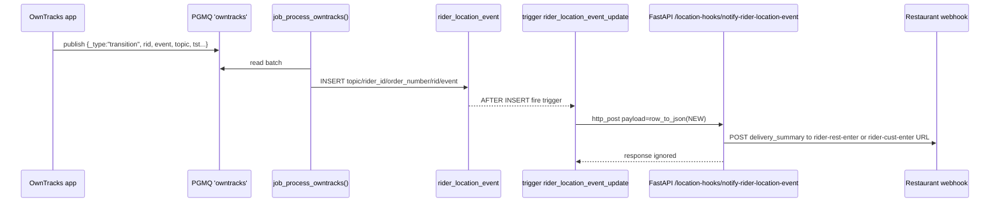

# Location Event Processing

This guide explains how OwnTracks location events travel from the queue into database tables and out to webhooks. It ties together `ordelo_datamodels/location.sql`, `ordelo_datamodels/jobs_n_functions/job_process_owntracks.sql`, and `watomation/routers/location_hooks.py`.

## End-to-End Flow

```mermaid
flowchart TD
  OT[OwnTracks mobile app<br/>publishes _type=location|transition] --> PGMQ[(pgmq queue 'owntracks')]
  Worker[job_process_owntracks()<br/>SQL job] -->|batch reads<br/>up to 1000 msgs| PGMQ
  Worker -->|INSERT location rows| RL[rider_location table]
  Worker -->|INSERT transition rows| RLE[rider_location_event table]
  RLE -->|AFTER INSERT trigger<br/>rider_location_event_update| Hook[http_post to /location-hooks/notify-rider-location-event]
  Hook --> API[FastAPI location_hooks router]
  API -->|POST rider-rest-enter / rider-cust-enter| Restaurant[Restaurant webhook\n(get_restaurant_webhook_url_async)]
```

Rendered SVG (offline-friendly): 

## Key Tables (`ordelo_datamodels/location.sql`)

- `rider_location`: Raw OwnTracks location points. Stores lat/lon, accuracy, battery, timestamps (`tst` epoch and `tst_dtts`), identifiers (`topic`, `rider_id`, `tid`), and region arrays (`inregions`, `inrids`). Indexed on `tst` and `dtts` desc for recent lookups.
- `rider_location_event`: One row per transition event. Columns: `topic`, `rider_id`, optional `customer_id`, `order_number`, `rid` (zone id such as `rest` or `cust`), `event` (`enter` / `leave`), plus audit timestamps.
- Trigger `trigger_rider_location_event_update` → function `rider_location_event_update()` builds `row_to_json(NEW)`, derives `app_url` from `ordelo_config` (`ORDELO_APP_URL`, default `https://rider-agent.ordelo.app`), normalizes trailing slash, and `http_post`s to `/location-hooks/notify-rider-location-event`. Response is ignored; inserts always succeed regardless of webhook status.

## Queue Processing Job (`ordelo_datamodels/jobs_n_functions/job_process_owntracks.sql`)

- Function: `job_process_owntracks()` (SECURITY DEFINER PL/pgSQL) returns processed count.
- Reads up to 1000 messages from `pgmq.read('owntracks', 0, 1000)`, parsing JSON payloads.
- Extracts `rider_id` from topic `owntracks/{rider_id}/...`, captures `_type`, `topic`, `tst` (epoch and `tst_dtts`), and keeps the original `msg`.
- Joins each message to `delivery_inflight` on `rider_id` to add `customer_id` and `order_number` context; messages without an inflight record are skipped.
- Routes by `_type`:
  - `_type='location'`: Inserts into `rider_location`, mapping accuracy/altitude/battery/coordinates/connection/device arrays and timestamps. No upserts—every reading is persisted.
  - `_type='transition'`: Inserts into `rider_location_event` with `topic`, `rider_id`, `customer_id`, `order_number`, `rid`, `event`. Always inserts new records.
- Collects processed `msg_id`s and archives them via `pgmq.archive('owntracks', msg_id)`; returns the number of archived messages.

## Webhook Handling (`watomation/routers/location_hooks.py`)

- Route `POST /location-hooks/notify-rider-location-event` receives the trigger payload (JSON of the inserted `rider_location_event` row).
- Pulls `event`, `rid` (named `location` in the handler), `customer_id`, and `order_number`. Fetches `delivery_summary` from Supabase via `client_ordelo.table("delivery_summary")`.
- On `event='enter'` and `rid='rest'`: fetches restaurant webhook URL with `get_restaurant_webhook_url_async(rest_ref, "rider-rest-enter")` and POSTs `{delivery_summary}` to `{webhook_url}/{order_number}` via `httpx`.
- On `event='enter'` and `rid='cust'`: same pattern with `rider-cust-enter`.
- Other event/rid combos currently return `{"event": "success"}` (no-op).

### Live Location Map Endpoint

- `GET /location-hooks/live-location-map/{order_number}` → uses `get_live_map_location_url` to redirect to a rider map link; returns 400/404 on invalid order or missing data.

## Sequence for a Transition Event



Rendered SVG (offline-friendly): 

## Running and Verifying the Flow

- Populate the queue (example): `SELECT pgmq.send('owntracks', '{"_type":"transition","topic":"owntracks/1234/abc-orderX/event","rid":"rest","event":"enter","tst":1738070000}');`
- Process a batch: `SELECT job_process_owntracks();` (returns processed count; archives messages).
- Check tables: `SELECT * FROM rider_location_event ORDER BY id DESC LIMIT 5;` and `SELECT * FROM rider_location ORDER BY dtts DESC LIMIT 5;`.
- Confirm webhooks: tail application logs for `location_hooks` or inspect restaurant webhook endpoints for received POSTs. The DB trigger ignores HTTP failures, so alerting should be added if delivery of hooks must be guaranteed.

## Operational Notes

- Ensure `ordelo_config` contains `ORDELO_APP_URL` to point triggers at the correct FastAPI host; otherwise it defaults to `https://rider-agent.ordelo.app`.
- The job skips messages for riders not present in `delivery_inflight`. Keep that table current to avoid dropped location data.
- The trigger uses `http_post` from the Postgres HTTP extension; confirm it is installed and outbound network is allowed from the database.
