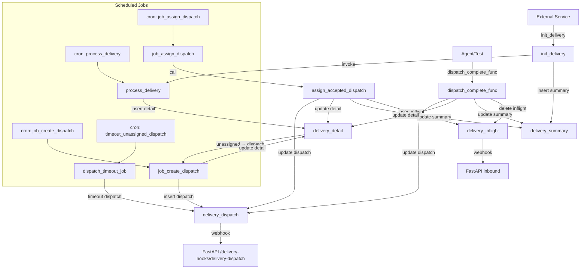

# Delivery Process Design

This document provides a clear, step-by-step reference for the Ordelo delivery workflow, covering initialization through completion and timeout handling.

---

## 1. init_delivery (Delivery Initiation)

**Invocation:**
- Called by external service: `init_delivery(p_cust_id VARCHAR, p_order_number VARCHAR)`

**Purpose:**
- Insert a new record into `delivery_summary` with restaurant & customer details
- Generate confirmation codes (restaurant & customer)
- Immediately invoke `process_delivery()` to seed the first `delivery_detail`

**Dependencies:**
- Tables: `customer_master`, `restaurant_master`, `ordelo_config`, `delivery_summary`

---

## 2. process_delivery (Delivery Detail Management)

**Invocation:**
- Scheduled via `pg_cron`: every 5 seconds

**Signature:**
```sql
CREATE FUNCTION process_delivery() RETURNS TABLE(action TEXT)
```

**Purpose:**
- For each `unassigned` order in `delivery_summary`:
  1. Determine next vehicle type by rank
  2. Insert a new `delivery_detail` record if none exists
  3. If all vehicle types timed out, mark `delivery_summary.status = 'timedout'`

**Dependencies:**
- Tables: `delivery_summary`, `delivery_option`, `delivery_detail`

---

## 3. job_create_dispatch (Dispatch Creation)

**Invocation:**
- Scheduled cron job: every 5 seconds

**Signature:**
```sql
CREATE FUNCTION job_create_dispatch() RETURNS TABLE(action TEXT)
```

**Purpose:**
- For each `delivery_detail` with `status = 'unassigned'`:
  1. Find available riders via `get_available_riders(order_number, town, vehicle_type)`
  2. Batch dispatch candidates by `DISPATCH_BATCH_SIZE_<VEHICLE_TYPE>`
  3. Insert into `delivery_dispatch` (status = 'unassigned')
  4. Update `delivery_detail.status = 'vehicle_type_timedout'` if no riders

**Side Effects:**
- Triggers webhook on `delivery_dispatch` insertion:
  - HTTP POST `/delivery-hooks/delivery-dispatch`
- Sends WhatsApp messages to riders

---

## 4. job_assign_dispatch & assign_accepted_dispatch (Dispatch Assignment)

**Invocation:**
- Scheduled cron job: every 5 seconds

**job_assign_dispatch Signature:**
```sql
CREATE FUNCTION job_assign_dispatch() RETURNS TABLE(action TEXT)
```

**Purpose:**
- Find `delivery_detail` rows with status `'unassigned'` or `'vehicle_type_timedout'`
- Call `assign_accepted_dispatch(order_number)` for each

**assign_accepted_dispatch Signature:**
```sql
CREATE FUNCTION assign_accepted_dispatch(p_order_number VARCHAR) RETURNS BOOLEAN
```

**assign_accepted_dispatch Purpose:**
1. Select first `delivery_dispatch` with `status = 'accepted'` and not already inflight
2. Update:
   - `delivery_dispatch.status = 'assigned'`
   - `delivery_detail.status = 'assigned'`, set `dispatch_id` & `rider_id`
   - `delivery_summary.status = 'assigned'`
3. Insert into `delivery_inflight` (kicks off rider graph & missed‐dispatch notification)

---

## 5. dispatch_complete_func (Dispatch Completion)

**Invocation:**
- Called by agent or tests when delivery is complete: `dispatch_complete_func(p_dispatch_id BIGINT)`

**Purpose:**
- Update:
  - `delivery_dispatch.status = 'completed'`
  - `delivery_detail.status = 'completed'`
  - `delivery_summary.status = 'completed'`
- Remove inflight record: `DELETE FROM delivery_inflight`

---

## 6. TimeoutUnassignedDispatch (Unassigned Dispatch Timeout)

**Process:**
- Periodic SQL job (e.g. cron script)

```sql
UPDATE delivery_dispatch
SET status = 'timedout'
WHERE status = 'unassigned'
  AND (current_timestamp - dtts) > INTERVAL '30 seconds';
```

---

## Workflow Diagram



---

*End of Delivery Process Design*
